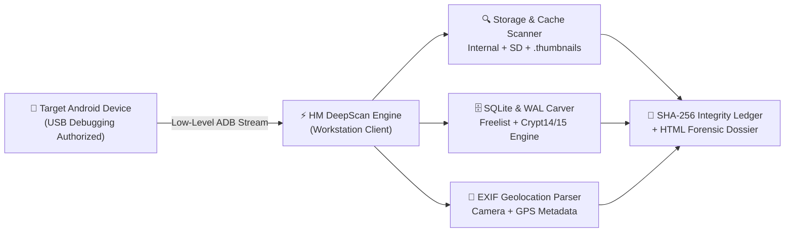

# 🛡️ HM DeepScan — Forensic Mobile & Media Acquisition Suite for Android
### **Engineered by [HMSTUDIOS.TECH](https://hmstudios.tech)**

[-0078D6?style=for-the-badge&logo=windows&logoColor=white)](https://hmstudios.tech)

**Non-Destructive Logical Extraction • Unindexed Cache & Thumbnail Carving • SQLite/WAL Artifact Reconstruction • EXIF Geolocation Intelligence**

---

### ⬇️ **OFFICIAL CLIENT DOWNLOAD (INTERNATIONAL BUILD)**

## 👉 [**Click Here to Download `HM_DeepScan_Protected.zip` (Direct 1-Click Download)**](https://github.com/Harismehd/HM-DeepScan/raw/main/HM_DeepScan_Protected.zip)

> 🔐 **Archive Extraction Password:** `1234`  
> 🔑 **Need a License Key?** Anyone can download the client above, but unlocking the forensic engine requires an active commercial License Key.  
> 👉 **[Purchase Your Instant License Key at HMSTUDIOS.TECH](https://hmstudios.tech)**

---

## ⚡ Executive Overview

**HM DeepScan** is a specialized digital forensics and mobile data acquisition utility developed under **HMSTUDIOS.TECH**. Designed for ethical security research, authorized personal data recovery, and forensic artifact preservation, HM DeepScan interfaces directly over low-level **Android Debug Bridge (ADB)** channels to locate, extract, hash, and reconstruct deleted or residual mobile artifacts without altering the target device's storage state.

Unlike generic consumer recovery utilities that often rely on misleading claims, **HM DeepScan** is built on transparent, verifiable forensic engineering principles:
* **Cryptographic Evidence Preservation:** Every acquired file is hashed in-memory using **SHA-256** and cataloged in a tamper-evident `HM_Cryptographic_Audit_Ledger.json` manifest while preserving original Unix epoch modification timestamps (`mtime`).
* **Multi-Layer Storage & Cache Carving:** Sweeps active directories, external storage mounts, orphaned `.thumbnails` blocks, and volatile 2:00 AM nightly staging buffers.
* **SQLite B-Tree & Write-Ahead Log (WAL) Analysis:** Inspects uncheckpointed `-wal` journals, freelist pages, and multi-backup differentials alongside native **AES-256-GCM (`.crypt14` / `.crypt15`)** decryption support when paired with an authorized device key.
* **Interactive Forensic Dossier Generation:** Compiles recovered media, voice notes, chat reconstructions, and SHA-256 verification tables into a standalone, offline HTML forensic report.

---

## 🔬 Core Forensic Modules

| Module | Capability | Forensic Output |
| :--- | :--- | :--- |
| **01. Logical Storage & Media Acquisition** | Dual-path internal (`/storage/emulated/0`) and external SD card scanning across standard & business messaging containers. | Timestamp-preserved media tree + `HM_Cryptographic_Audit_Ledger.json` |
| **02. Non-Index Memory & Cache Carver** | Extracts unindexed gallery cache blobs, `.thumbnails` remnants, and orphaned preview buffers that remain after standard gallery deletion. | `HM_NonIndex_Memory_Carve/` binary payloads with SHA-256 seals |
| **03. SQLite WAL & Freelist Carver** | Scans SQLite database pages, unallocated cell fragments, and `-wal` rollback journals for deleted message strings and metadata. | `HM_Forensic_Chat_Report.html` & reconstructed timelines |
| **04. Crypt14 / Crypt15 Decryption Engine** | Native zlib + AES-256-GCM decryption pipeline for local WhatsApp database archives (`msgstore.db.crypt14` / `.crypt15`) using user-supplied 158-byte key files or 64-char hex keys. | Decrypted `msgstore_decrypted.db` + Differential Deleted Chat Report |
| **05. EXIF & Geolocation Intelligence** | Parses binary EXIF headers, camera hardware fingerprints (Make, Model, Lens, ISO, Aperture), and converts DMS GPS coordinates into direct Google Maps links. | Interactive CLI & Dossier Geolocation Report |

---

## 🛠️ Architecture & Acquisition Pipeline

---

## 🚀 Quick-Start Guide for License Holders

### Step 1: Download & Extract
1. Download **[HM_DeepScan_Protected.zip](https://github.com/Harismehd/HM-DeepScan/raw/main/HM_DeepScan_Protected.zip)** to your Windows 10/11 PC.
2. Right-click the downloaded `.zip` file and select **Extract All** (or extract using WinRAR / 7-Zip).
3. Enter the archive password when prompted: **`1234`**
   > *Note: Always extract the full folder to your Desktop or Downloads before running—do not run the executable directly from inside a preview window.*

### Step 2: Prepare Your Android Device
1. Connect your Android phone to your PC using a **data-capable USB cable**.
2. Enable **Developer Options** on your phone:
   * Navigate to **Settings** → **About Phone** → tap **Build Number** 7 times rapidly until you see *"You are now a developer!"*.
3. Go back to **Settings** → **System / Additional Settings** → **Developer Options** and turn **USB Debugging ON**.
4. Set USB mode to **File Transfer (MTP)** (or **PTP** on certain Realme/ColorOS devices if MTP restricts the ADB interface).
5. When the prompt *"Allow USB debugging?"* appears on your phone screen, check **"Always allow from this computer"** and tap **Allow**.

### Step 3: Launch & Activate
1. Open the extracted folder and double-click **`HM_DeepScan.exe`**.
   * *If Windows SmartScreen displays a prompt ("Windows protected your PC"), click **More info** → **Run anyway**.*
2. Enter your commercial **License Key** (`HMDS-XXXX-XXXX-XXXX`) received from **[hmstudios.tech](https://hmstudios.tech)**.
3. Select **Option [2]** from the main interface to begin automated device acquisition, or **Option [3]** / **[4]** for specialized database carving and EXIF metadata analysis.

---

## ⚖️ Ethical Scope, Technical Boundaries & Legal Disclaimer

**HM DeepScan** is built for **authorized use only**. By downloading or operating this software, you agree to the following:

1. **Ownership & Authorization:** You must be the legal owner of the target device or hold explicit written authorization from the owner.
2. **Cryptographic & Physical Realities:** Data that has been physically overwritten on NAND flash storage or sanitized via a hardware Factory Reset on modern File-Based Encrypted (FBE) devices cannot be recovered by any software utility. Recovery results depend strictly on un-overwritten storage sectors, cache retention, and local database states.
3. **Zero Tampering Guarantee:** HM DeepScan operates in a strictly read-only forensic acquisition manner on the connected device and never modifies or deletes user data.

---

## 👨‍💻 About the Founder & HMSTUDIOS.TECH

**HMSTUDIOS.TECH** was founded by **Haris Mehmood**—a Cybersecurity & Computer Science student, ethical hacking researcher, and digital forensics builder dedicated to bridging academic cybersecurity research with practical, real-world forensic tools.

What began as an independent student research initiative to expose online data-recovery scams and explore mobile artifact preservation has evolved into a globally deployed forensic suite serving clients across multiple countries.

* 🌐 **Official Portal & Licensing:** [https://hmstudios.tech](https://hmstudios.tech)
* 📸 **Instagram:** [@hmstudios.tech](https://instagram.com/hmstudios.tech)
* 📩 **Technical Support & Inquiries:** [hmstudios.tech@gmail.com](mailto:hmstudios.tech@gmail.com)

---

  © 2026 <b>HMSTUDIOS.TECH</b> — All Rights Reserved. Built with precision for Digital Forensics & Cybersecurity Awareness.

